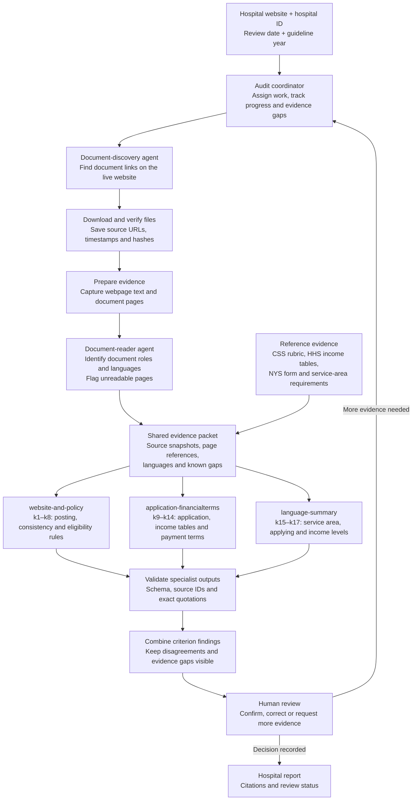

# Hospital audit agents and task model

This guide describes the task model, specialist responsibilities, and 17 audit
criteria. See [agents/README.md](agents/README.md) for CLI commands, source reuse,
debugging targets, cost controls, and criterion-specific implementation limitations.

All 17 criteria are wired into the CLI. Their findings remain drafts for human
review; implemented steps can still produce unresolved results. The topology below
describes the conceptual design, not a claim that every proposed handoff or final
reporting stage is implemented.

## Abstraction: what the agents should achieve

For each hospital, we want to determine whether its published financial-assistance
materials satisfy each of the 17 criteria, with traceable evidence supporting
every true or false determination.

We model this work as a graph of task instances. Each node represents a specific
unit of work for a hospital, document or criterion. Edges express dependencies:
a task can run once its required inputs are available. Agents are the workers
assigned to these nodes according to their capabilities; agents are not the nodes.

At a high level, the work is to:

1. **Discover sources:** locate the hospital's relevant webpages and document links.
2. **Collect evidence:** retrieve and verify sources, read their contents, and
   preserve observations with source identities and precise locations.
3. **Evaluate criteria:** assign capable agents to assess each criterion using
   the collected evidence and the applicable rubric and reference materials.
4. **Account for every outcome:** assemble a hospital assessment covering all
   17 criteria, retaining supporting evidence, conflicting observations and
   unresolved questions.

The system must let us answer, for any hospital and criterion: **What task was
performed? Which agent performed it? What evidence did it use? What conclusion
did it reach?** Task assignments, execution status, attempts and results must
therefore be tracked explicitly.

The goal is an evidence-backed assessment, not merely completed agent calls.
Successful execution does not imply a hospital satisfies a criterion, and a
failed execution does not imply a hospital violates it. Unresolved criteria
remain visible until sufficient evidence supports a determination. Any overall
hospital conclusion must follow the applicable aggregation rules and must not
silently treat unresolved criteria as satisfied.

The sections below define the task set, agent capabilities, criteria, evidence
and determinations underlying this abstraction. This section describes the
intended system, not a claim that the full workflow is already implemented.

## Agent topology and handoffs

The CLI coordinates criterion execution and persists progress. Source acquisition,
integrity checks, extraction, citation validation and aggregation are code stages;
agents interpret the supplied evidence. The shared evidence packet and final
human-review/reporting flow below describe the intended architecture.

### Responsibilities

- **Coordinator:** owns the hospital run, assigns work and combines results. Each
  specialist owns its criteria; coordination does not silently rewrite findings.
- **Discovery:** finds links. Downloading, verification and text extraction are
  code/tool stages; a discovered link does not prove a document is accessible.
- **Document reader:** identifies roles and languages from contents, one document
  at a time. Extracted text does not establish that visual layout was reviewed.
- **Specialists:** assess their assigned criteria using relevant sources and known
  gaps. The branches represent responsibilities, not a requirement for parallel
  execution. Explicit source loops keep cost and debugging manageable.
- **Validation:** checks format and citation integrity, not semantic correctness.
  Earlier criteria have criterion-specific confirmation/repair calls; k12–k17 use
  one reading per scoped source without automatic retries. Failed readings remain
  visible and never establish hospital noncompliance.
- **Human review:** resolves interpretation questions and records decisions.
  Missing references or incomplete evidence produce unclear draft findings rather
  than assumed passes or failures. New evidence creates a new scoped review.

Current language scope is English/Spanish. Language availability is a separate
observation, not an eighteenth criterion. Different extraction outcomes do not
establish translation discrepancies; comparisons require paired verified evidence.

## Set of tasks

Let **T** denote the set of tasks:

$$
T = \{t_1, t_2, \ldots, t_n\}
$$

Each task represents one defined unit of work, independent of which agent performs it.

Examples include discovering a hospital's document links, reading a document,
and evaluating a criterion using collected evidence.

A **task definition** describes the work, such as "read a document." A **task
instance** specifies that work for particular inputs, such as "read document
d for hospital h."

## Set of agents

Let **A** denote the set of agents:

$$
A = \{a_1, a_2, \ldots, a_m\}
$$

Each agent can handle a subset of T. Define the capability mapping:

$$
C : A \rightarrow \mathcal{P}(T)
$$

Here, the power set of T, written as P(T), is the set of all subsets of T.
For each agent a, its capability set satisfies:

$$
C(a) \subseteq T
$$

## Task coverage

Every task must have at least one capable agent:

$$
\bigcup_{a \in A} C(a) = T
$$

Capability sets may overlap: multiple agents may be capable of handling the
same task. Capability does not yet specify which agent is assigned to execute
a particular task instance.

## Set of criteria

Let **K** denote the set of 17 criteria being evaluated. We use K to distinguish
criteria from the agent capability mapping C:

$$
K = \{k_1, k_2, \ldots, k_{17}\}
$$

Each criterion is a proposition to determine as true or false for a hospital:

Specialist ownership is **website-and-policy** for k1–k8,
**application-financialterms** for k9–k14, and **language-summary** for k15–k17.

| Criterion | Proposition |
| --- | --- |
| k1 | The financial-assistance application is available online. |
| k2 | A plain-language financial-assistance summary is available online. |
| k3 | The full financial-assistance policy is available online. |
| k4 | The website, policy, application and summary are consistent with one another. |
| k5 | The hospital's service area meets applicable geographic requirements. |
| k6 | Patients can apply at any time without a submission deadline. |
| k7 | Eligibility is determined without testing patients' assets. |
| k8 | Patients can qualify regardless of immigration status. |
| k9 | The hospital uses the complete New York State Uniform Application. |
| k10 | The application provides contact information for assistance. |
| k11 | The application includes income limits and discount tables. |
| k12 | Federal Poverty Level figures are correct for the year being reviewed. |
| k13 | Patients with incomes up to at least 400% of the Federal Poverty Level can qualify. |
| k14 | Monthly installments are capped at 5% of gross monthly income. |
| k15 | The summary describes the geographic area the hospital serves. |
| k16 | The summary explains how to apply for financial assistance. |
| k17 | The summary specifies the income levels eligible for assistance. |

These propositions correspond to [the existing 17-criterion rubric](rubrics/css-17-v1.json).
The rubric supplies their detailed scope and evidence requirements.

## Evidence datapoints

Let **E** denote the set of collected evidence datapoints:

$$
E = \{e_1, e_2, \ldots, e_p\}
$$

An evidence datapoint records a traceable observation:

$$
e = (h, s, \ell, o, \tau)
$$

- **h:** the hospital the observation concerns.
- **s:** the source identity, including its URL and saved snapshot identity/hash.
- **l:** the location within that source, such as a PDF page, section or table cell.
- **o:** the observed content, such as an exact original-language quote or table value.
- **tau:** when the source was retrieved or the observation was recorded.

Evidence is a source observation, not an agent's unsupported conclusion.
One datapoint can inform multiple criteria, and one criterion may require
multiple datapoints, including evidence from different documents.

## Criterion determinations

Let **H** denote the set of hospitals being assessed. For each hospital and
criterion, a completed determination contains a Boolean value and its evidence:

$$
D : H \times K \rightharpoonup \{\mathrm{true}, \mathrm{false}\} \times \mathcal{P}(E)
$$

$$
D(h, k) = (b, E_{h,k})
$$

Here, **b** states whether the criterion is satisfied, and **E(h,k)** is the
nonempty set of evidence datapoints used to support that determination. Each
cited datapoint must be relevant to the hospital and criterion under review.

The partial-function arrow means a determination can remain undefined while
work is pending or evidence is insufficient. An undefined determination is
**not false**. Missing evidence or a failed task must not become an automatic
pass or failure. Any rubric exemption is recorded separately from the Boolean
determination.

Thus, the outcome we seek for each applicable criterion is not just true or
false, but **true or false backed by traceable evidence**.

### Recording results

Report outcomes as **Yes**, **No**, **Unclear**, or **Not applicable**, supported
by source citations. The CLI represents unresolved findings as `null`; a rubric
exemption must justify not applicable. Model findings are drafts pending human
review. Some rubric interpretation and grading decisions still await subject-matter
approval. See [the CLI guide](agents/README.md) for execution status, saved task
graphs, manifests, and current limitations.
