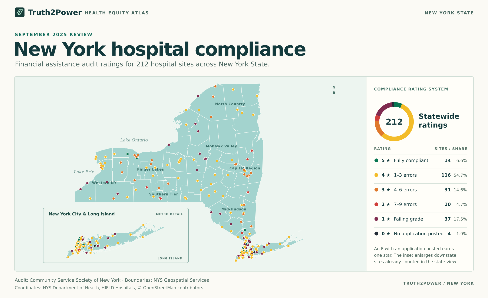

# New York hospital compliance

The map covers all 212 hospitals in the Community Service Society of New York’s September 2025 financial assistance review. Select a point or search for a hospital to see its latitude, longitude, coordinate source, financial assistance page, and original audit row. Select a rating to filter the map. The NYC–Long Island inset repeats the 83 sites in New York City, Nassau County, and Suffolk County.

- Download [the interactive map](index.html) and open the HTML in a browser. The map works offline. Source links open online.
- [CSV coordinates](../data/maps/hospital-coordinates.csv) use separate latitude and longitude columns in decimal degrees.
- [GeoJSON points](../data/maps/hospitals.geojson) use WGS 84 coordinate pairs in longitude, latitude order. Each feature links to its audit row and identifies the corresponding file under `data/`.

## Ratings

| Stars | September 2025 audit result | Sites |
| ---: | --- | ---: |
| 5 | A · Fully compliant | 14 |
| 4 | B · 1–3 errors | 116 |
| 3 | C · 4–6 errors | 31 |
| 2 | D · 7–9 errors | 10 |
| 1 | F · Application posted | 37 |
| 0 | F · No application posted | 4 |

The one- and zero-star groups split the original F grade on the audit’s “Application Posted” field. The counts come from the [hospital review](https://docs.google.com/spreadsheets/d/17S2EheUVVr1g911fPpBQJqRpy18pkUlaEEnvGM0LB1o/edit#gid=504145376).

## Location sources

208 locations matched the audit’s permanent facility identifier in the [NYS Department of Health facility directory](https://health.data.ny.gov/Health/Health-Facility-General-Information/vn5v-hh5r). The remaining four are documented individually.

| Audit site | Location match |
| --- | --- |
| Claxton-Hepburn Medical Center | Same street address and city at 214 King Street, Ogdensburg. The audit lists PFI 798. The state directory identifies the campus at that address as [15684](https://health.data.ny.gov/resource/vn5v-hh5r.json?fac_id=15684). |
| Mount Sinai South Nassau | HIFLD’s South Nassau Communities Hospital record at 1 Healthy Way, Oceanside. |
| Wyckoff Heights Medical Center | HIFLD’s hospital record at 374 Stockholm Street, Brooklyn. |
| Cohen Children’s Medical Center | The audit omits the PFI and address. The [named hospital site](https://www.openstreetmap.org/node/357616936) supplies the coordinates at 269-01 76th Avenue, New Hyde Park. |

All 212 points fall within one of the 62 [NYS shoreline-clipped county boundaries](https://gisservices.its.ny.gov/arcgis/rest/services/NYS_Civil_Boundaries/MapServer/3). Location data identify hospital sites. Ratings describe the September 2025 review.

Coordinate sources include the [HIFLD Hospitals layer](https://services2.arcgis.com/FiaPA4ga0iQKduv3/ArcGIS/rest/services/Extract_Data_Hospitals_HIFLD/FeatureServer/0) and [© OpenStreetMap contributors](https://www.openstreetmap.org/copyright). Boundaries are from NYS Office of Information Technology Services, Geospatial Data Services.
